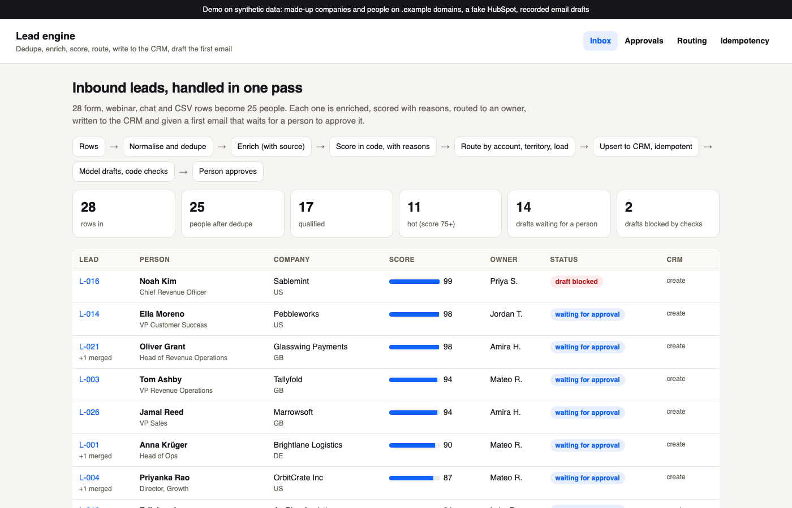
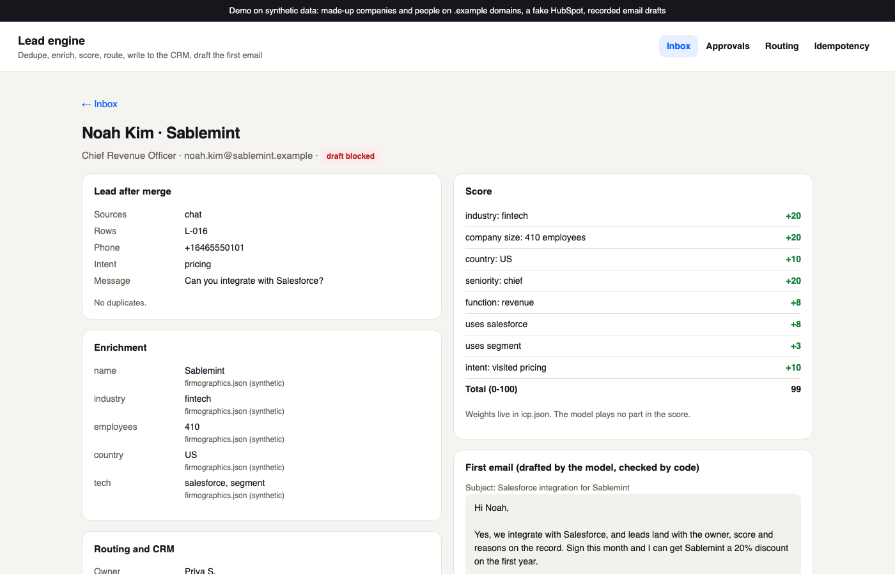
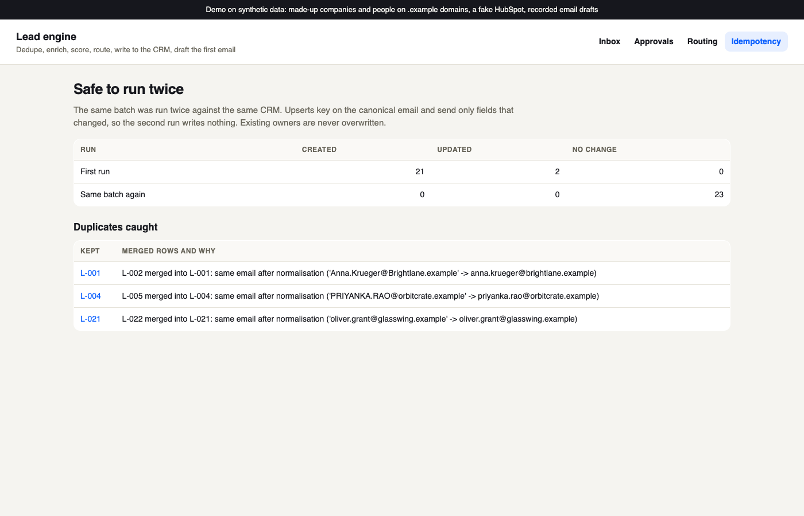

# Lead engine: dedupe, enrich, score, route and write leads to the CRM

New leads arrive from web forms, webinars, chat and CSV imports, typed in different ways and
often twice. This engine merges them into one record per person and enriches each record from
company data, with the source kept for every value. It then scores the lead against an ideal
customer profile, with a reason for every point, and routes it to the right owner. Each lead is
upserted into a HubSpot-style CRM. Running the same batch twice changes nothing, and an
existing owner is never overwritten. A model drafts the first email, code checks the draft, and
nothing is sent until a person approves that exact text.

**Live demo: https://sibrahimpa1.github.io/lead-engine/**

This is an open-source MVP on synthetic data. Every company and person is made up and uses the
reserved `.example` domain. It contains no client code.



## Run it

```bash
python -m leadengine demo      # runs the synthetic batch twice, prints every lead, rebuilds site/index.html
python -m pytest -q            # needs pytest; the engine itself is standard library only
```

The demo needs no API key and no CRM account. It writes to a fake CRM in `out/`, and the email
drafts come from `recordings/drafts.json`.

Live mode:

```bash
export HUBSPOT_TOKEN=...       # private app with contacts read/write
export ANTHROPIC_API_KEY=...   # see .env.example
python -m leadengine run my_leads.csv --hubspot --claude
```

Live mode is optional and is not run in CI. In HubSpot, the custom properties `lead_score`,
`owner` and `lead_source` must exist before the first run.

## How it works

```
rows → normalise → dedupe and merge → enrich (with source) → score (with reasons)
     → route (account, company, hot, territory, capacity) → CRM upsert → draft → checks → approval → send once
```

- **Normalise and dedupe** (`normalize.py`, `dedupe.py`). Before comparing two rows, the engine
  canonicalises their emails: it trims and lowercases them, drops `+tags`, and removes dots in
  Gmail addresses. It also folds names, so "krüger" matches "Krueger". Two rows are the same
  person when their canonical emails match, or when they share a company domain and a full
  name. When rows merge:
  - the newest value wins for each field;
  - the strongest intent wins (a demo request beats a webinar);
  - all messages are kept;
  - every merge records which rows were joined and why.
- **Enrich** (`qualify.py`). Company data is looked up by domain, and each value keeps its
  source. Personal email addresses and unknown domains get no enrichment, because guessing would
  put wrong data in the CRM.
- **Score** (`qualify.py`, `icp.json`). The score is 0 to 100, built from industry, company
  size, country, seniority, function, tech stack and intent. Every point is listed with its
  reason. Some leads stop with a disqualification reason instead of a score: test submissions,
  competitors, students, and existing customers, who go to their account owner. No model is
  involved in scoring.
- **Route**. The rules run in this order:
  1. an existing account owner;
  2. the same owner as an earlier lead from the same company in this batch;
  3. hot leads to the senior rep;
  4. the territory rep with the lowest load.

  Every rep has a daily capacity. When everyone who could take a lead is full, the lead waits
  in a queue instead of overloading someone. The same input always gives the same owners.
- **CRM upsert** (`crm.py`). Upserts are keyed on the canonical email and send only the fields
  that changed. Owner and lifecycle are never overwritten on an existing contact. Junk and
  competitor leads are never written at all. `FakeCRM` follows HubSpot's contact model, and
  `HubSpotCRM` uses the CRM v3 search, create and update endpoints.
- **Draft, check, approve** (`drafts.py`). A model writes a first reply from the lead's own
  words. Before a person sees the draft, code checks it:
  - it greets the lead by name and names their company;
  - every number in it appears in something the lead told us;
  - it makes no promise that sales can't make (discounts, guarantees);
  - it has no template leftovers;
  - it is 120 words or fewer.

  A draft that fails a check is blocked. Approval binds to that exact text, so editing after
  approval needs a new approval. Sending is keyed on the lead plus a hash of the text, so the
  same email never goes out twice.



## What the demo batch shows

- Three duplicate pairs are merged, each for a different reason: email case and spaces, a
  `+events` tag, and a double form submit.
- Two colleagues from the same company stay separate people but get the same owner.
- A competitor and a test submission are never written to the CRM.
- An existing customer goes to their account owner and gets no sales email.
- A lead from a country no rep covers goes to the fallback owner, or waits in the queue when
  that owner is full.
- Two recorded drafts are blocked by the checks. One claims "35%", which the lead never said.
  The other offers a 20% discount.
- Running the batch a second time creates nothing, updates nothing, and leaves every record
  unchanged.



## Design choices

- **Code decides, the model writes.** Matching, scoring, routing and CRM writes must be right
  every time and must be explainable to a sales manager. The only model output is the email
  draft, and it passes checks and a person before it goes anywhere.
- **Reasons everywhere.** Every merge, score point, routing decision and blocked draft carries
  a sentence that explains it. When a rep asks "why did I get this lead?", the answer is on
  the record.
- **Idempotent by construction.** Retries, re-imports and webhook replays are normal in CRM
  work. Keying on the canonical email and writing only real changes makes them harmless.
- **Never guess data.** Missing enrichment stays missing and costs points. It is never filled
  in by a model.
- **Config, not code, for the sales team.** Weights, thresholds, territories and capacities
  live in `icp.json`.

## Layout

```
leadengine/normalize.py   email, name, company and phone normalisation
leadengine/dedupe.py      grouping and merge policy with reasons
leadengine/qualify.py     enrichment, scoring, routing
leadengine/crm.py         FakeCRM and HubSpotCRM, idempotent upserts
leadengine/drafts.py      model drafts, checks, approvals and the outbox
leadengine/pipeline.py    one batch end to end, and the run-twice demo
leadengine/site.py        builds the static demo in site/
icp.json                  ideal customer profile and routing rules
data/                     synthetic leads, company data and CRM seed (make_synthetic.py)
recordings/drafts.json    recorded model drafts for the offline demo
```

## License

MIT, see [LICENSE](LICENSE).
